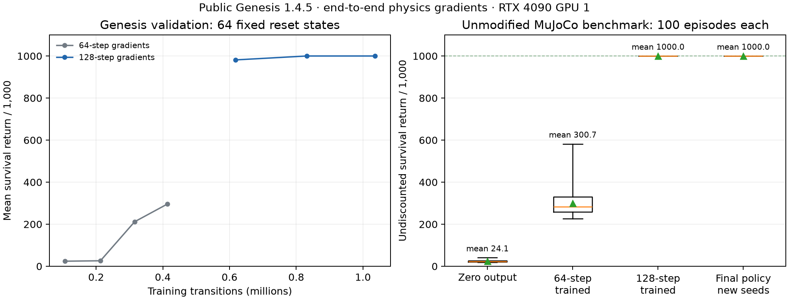

# Public Genesis: InvertedPendulum-v5

The 64 → 128 step curriculum learns from zero policy output and scores
**1,000/1,000 in every one of 100 unmodified Gymnasium/MuJoCo episodes**.
It also passes all 64 Genesis evaluation episodes. The original zero-output
policy averages 24.1/1,000, with no successful episodes.

A separate evaluation on **100 new seeds (20000–20099)** also scores
1,000/1,000 in every episode, with zero early terminations. Its
[episode records](independent-evaluation/evaluation.json),
[40-second replay](independent-evaluation/replay.mp4), and
[state/action trace](independent-evaluation/trace.csv) are saved. The final
[checkpoint](matched-h128/latest.pt) is the same one used for this evaluation.



## Method and scope

- Host: A843-2x4090 (`15004-2x-4090`), physical GPU 1, process-local `cuda:0`.
- Public PyPI Genesis 1.4.5, Quadrants 1.3.3, Torch 2.14.1+cu130,
  Gymnasium 1.4.0, MuJoCo 4.0.0. No Genesis fork or simulator source patch.
- The MJCF comes from Gymnasium. Genesis's automatic rotor armature addition
  is disabled; `model_observed.json` records `[0, 0]` armature and `[1, 1]`
  damping. The cart force range is ±300 N, corresponding to motor control
  ±3 with gear 100. Policy interval is 0.04 s; Genesis uses four substeps.
- Policy: five learned parameters, `3*tanh(W*[x,theta,xdot,thetadot]+b)`.
  Every parameter starts at zero. There is no hand-coded stabilizing feedback.
- Loss: mean weighted state cost `x² + 10θ² + 0.1(xdot² + θdot²)`, averaged
  over all environments and times. It contains no direct action penalty;
  every policy gradient must pass through simulated states.
- Full closed-loop backpropagation inside each rollout, with no critic,
  internal state detach, learned dynamics model, imitation, or PPO. L-BFGS uses
  analytic simulator gradients, including for its line-search trials.
- Training starts each outer step from 64 fresh uniform resets in
  `[-0.01, 0.01]^4`. Line-search trials within that step reuse the same resets.
  Requested and observed first resets are both saved.

The [artifact audit](artifact-audit.json) confirms 64 distinct observed first
reset states in each successful stage, with zero error against the requested
states. It also records the checkpoint SHA-256, independent evaluation seed
range and termination counts, and replay metadata (1,000 frames at 25 fps).

The training cost is a smooth surrogate. The benchmark's piecewise-constant
survival reward does not itself supply a useful pathwise balancing gradient.
Evaluation uses the **original** Gymnasium environment, reward, action bounds,
and termination: one reward per healthy step, at most 1,000 steps (40 seconds).
Success means reaching the time limit without termination. The policy is
deterministic; reset states are randomized.

This reproduces an RL **task** with differentiable policy optimization, not
SHAC's algorithm or its published scores. It does not establish Go2 locomotion
or reliable contact gradients. There is one training seed, not a multi-seed
training reliability study.

## Successful curriculum

| Stage | Outer L-BFGS steps | Gradient rollouts | Cumulative training transitions | Gym mean / minimum | Gym successes | Genesis mean |
| --- | ---: | ---: | ---: | ---: | ---: | ---: |
| Zero output | — | — | 0 | 24.10 / 18 | 0/100 | — |
| [64-step horizon](matched-h64/) | 4 | 101 | 413,696 | 300.69 / 226 | 0/100 | 308.39 |
| [128-step horizon](matched-h128/) | 3 | 76 | 1,036,288 | 1000 / 1000 | 100/100 | 1000 |

An outer L-BFGS step can perform many objective/gradient evaluations. Transition
counts include every training line-search rollout, including rejected trials;
they exclude validation and benchmark evaluation. Each final evaluation uses
`latest.pt`, not a checkpoint selected on benchmark scores. Both stages keep the
same differentiable Genesis solver for training and Genesis evaluation.

Training seeds start at 42 and advance with the global outer-step index.
Validation uses a separate fixed batch drawn with seed 500000. Development
benchmark episodes use seeds 10000–10099; these scores were inspected while
developing the recipe. Genesis's final 64 states are drawn from one RNG seeded
10000; these are not paired one-for-one with the 100 Gymnasium resets.

Run the recorded curriculum followed by a separate evaluation from the NAS
checkout on A843-2x4090:

```sh
PHYSICAL_GPU=1 bash scripts/reproduce_inverted_pendulum.sh runs/my-reproduction
```

Each stage's directory contains its configuration, package versions, source and
MJCF hashes, reset records, optimizer metrics, final checkpoint, and episode
results. The server builds its own `.venv` with `uv sync --extra cuda`; the
environment was not transferred from the workstation.

## Retained unsuccessful attempts

These are useful failure evidence, not alternative solved reproductions:

| Directory | Model / training | Gym mean return | Gym successes |
| --- | --- | ---: | ---: |
| `seed42-h64` | Added armature 0.1; Adam, 150 × 64-step updates | 142.26 | 0/100 |
| `seed42-h64-continued` | Same; 150 additional 64-step updates | 200.18 | 0/100 |
| `seed42-h256` | From first stage; 150 × 256-step updates | 378.62 | 0/100 |
| `seed42-lbfgs` | From that 256-step policy; three L-BFGS outer steps | 567.40 | 0/100 |
| `failed-h256` | Zero added armature; direct 64 → 256 continuation, lr 1.0 | Failed in backward | — |
| `failed-h1000` | Balanced 128-step policy; first 1,000-step backward pass | Failed in backward | — |

The added-armature L-BFGS policy scores 995.125 in Genesis but only 567.40 in
MuJoCo. This exposed a model mismatch that the current configuration removes.
Genesis's integrator still differs from MuJoCo RK4; matching the XML alone does
not make the simulators identical. The two 150-update continuations use equal
optimizer-update counts but **different transition budgets**, so they are not
a sample-matched horizon ablation.

The failed zero-armature 256-step run raises a NaN-gradient error inside a
line-search trial; its traceback is retained. The successful continuation uses
128 steps and learning rate 0.1. That changes two factors and does not isolate
the numerical failure's exact cause. See the
[full diagnosis and papers](../diagnosis-20261106/README.md).

The 1,000-step attempt is a stronger distinction: it fails on the **first**
gradient evaluation, before any optimizer change or line-search trial. Its
forward state cost is finite, `3.29051e-5`; Genesis reports a NaN gradient at
step 818 while reversing the rollout. `failed_rollout.json` preserves the
unchanged policy and reset seed 49. A subsequent
[checkpoint-replay diagnosis](../nan-backward-20261106/README.md) identifies the
cause: reconstructing 1,000 steps from taped actions amplifies an initial
float32 discrepancy until the reconstructed pendulum falls over. Using
25-step checkpoint intervals preserves the forward loss and completes the
full 1,000-step backward pass with finite gradients and no detach. The saved
trained policy above still uses the 64/128-step curriculum; this diagnostic
does not update its parameters.
